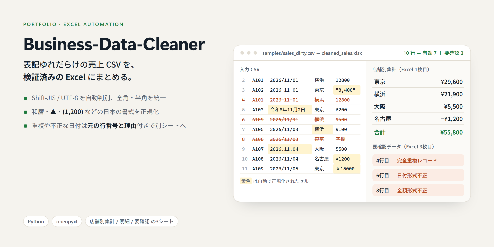

<p align="center"></p>

# Business-Data-Cleaner

**Turns a messy Japanese sales CSV into a checked Excel workbook: totals per store, cleaned rows, and every rejected row with its line number and reason.**

[](LICENSE)


[日本語](README_JA.md)

## Use it

```bash
pip install -r requirements.txt          # openpyxl
python clean.py 売上.csv                  # -> 売上_cleaned.xlsx
python clean.py 売上.csv -o 結果.xlsx --key 伝票番号 --date 売上日 --group 部門 --amount 売上
python clean.py 売上.csv --json          # summary on stdout, for other scripts
```

```text
sales_dirty.csv（utf-8）: 10 行 → 有効 7 行 ＋ 要確認 3 行
  名古屋: -¥1,200
  大阪: ¥5,500
  東京: ¥29,600
  横浜: ¥21,900
  要確認 4行目: 完全重複レコード (Duplicate of Line 2)
  要確認 6行目: 日付形式不正 (Invalid Date: 2026/11/31)
  要確認 8行目: 金額形式不正 (Invalid Amount: )
```

Exit code 0 on success, 2 for a missing file, an unreadable encoding or a column name that is not in the CSV
(the message lists the columns that are there).

## What it handles

| Input problem | Handling |
| :--- | :--- |
| Encoding | UTF-8, UTF-8 with BOM, Shift-JIS (CP932), detected from the whole file |
| Full-width / half-width | NFKC: `１２，８００` → `12,800`, ideographic spaces trimmed |
| Dates | `2026/11/1`, `2026-11-01`, `2026.11.1`, `2026年11月1日`, `20261101`, `令和8年11月2日`, `令和元年`, `R8.11.2`, `平成31年4月30日`, `H31/4/30`, `昭和…`; impossible dates such as `2026/11/31` are rejected |
| Amounts | `¥12,800`, `12800円`, `▲1,200`, `△500`, `(1,200)`, `-¥500`, `−300` (U+2212), `12,800.0`; fractional yen is flagged for a human |
| Duplicates | Same ID with identical content → duplicate; same ID with different content → conflict; both flagged with the line of the first one |

Output workbook: **店舗別集計** (totals and counts), **整形済み明細** (clean rows with original line numbers),
**要確認データ** (rejected rows, reason, original row as JSON).

## Use from Python

```python
from cleaner import DataCleaner              # src/ on sys.path
from excel_exporter import export_clean_workbook
result = DataCleaner(key_field="伝票番号").clean_csv("売上.csv")
export_clean_workbook(result, "結果.xlsx")
```

## Tests

```bash
python tests/test_cleaner.py
```
Covers the sample file, every format in the table above, a UTF-8 file whose 4096th byte splits a character,
a CP932 file, custom column names in the Excel output, and the command line.

## License

[MIT](LICENSE)
