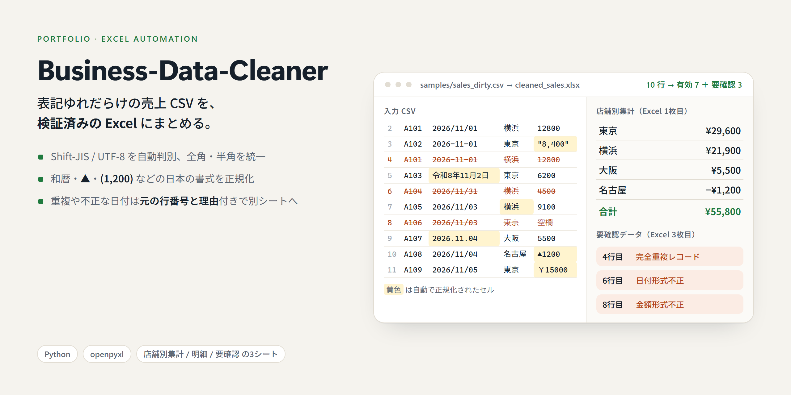

<p align="center"></p>

# Business-Data-Cleaner: 日本語業務データ整形・検証・Excel自動生成

<div align="center">

**重複除去 · 和暦/西暦正規化 · 全角半角統一 · エラー監査ログ付き多シートExcel出力**

</div>

---

## 1. 概要と強み

ECサイト、基幹システム、POSレジ等からエクスポートされた未整形の売上CSV/Excelデータを、業務で使用可能な品質へ自動変換・集計します。

* **自動文字コード判定**: Shift-JIS (CP932) および UTF-8 (BOM有無) を自動識別。
* **日本語データ特有の表記揺れ吸収**:
  * 全角数字・英字・記号の半角化、全角スペース（`\u3000`）の正規化。
  * 和暦（令和・R表記）および複数日付フォーマット（`/`, `.`, `-`）を ISO規格（`YYYY-MM-DD`）へ統一。
  * 存在しない日付（例: 11月31日）のバリデーション検知。
  * 日本の会計特有の三角表記（`▲1,200` 等のマイナス金額）や記号（`¥`, `円`）の自動パース。
* **トレーサビリティの確保**:
  * 有効データだけでなく、除外・要確認となった行について「元CSVの何行目で、どのような理由で弾かれたか」を明記した別シートを出力。

---

## 2. 実行手順

```bash
python tests/test_cleaner.py
```

---

## 3. ライセンス
MIT License
